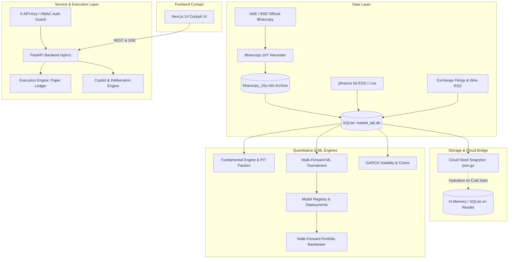

# Market Intelligence Lab (MIL) — Engineering Master Plan & Architectural Roadmap

> **Authoritative Technical Specification & Execution Blueprint**  
> **Repository:** `Market_Intelligence_Lab`  
> **Status:** Active / Production Hardened  
> **Date:** November 2026  
> **Revision:** v2.0 (Post-Audit Remediation)

---

## 1. Executive Summary & Core Diagnosis

The Market Intelligence Lab (MIL) codebase represents an institutional-grade, multi-surface quantitative research and paper-trading platform for Indian Equities (NSE/BSE). Following a rigorous audit of the 333-file source tree, local 2.84M-bar SQLite database (`market_lab.db`), GitHub Actions workflows, Render container limitations (512 MB RAM), and Next.js cockpit frontend, this Master Plan establishes:

1. **Security & State Invariants:** Elimination of unauthenticated mutating endpoints and preservation of portfolio state across cloud restarts.
2. **Point-in-Time Data Integrity:** Strict isolation of historical quant factors from future lookahead leakage (no unconstrained sector medians or backfilled fundamental metrics).
3. **Realistic Quantitative Backtesting (ADR-0009):** Transition from same-session close fills and distorted price-level averages to next-session ($t+1$) market Open execution with true equal-weighted return compounding and statutory Indian friction.
4. **Machine Learning Rigor:** Removal of manufactured fallback metrics (`0.038` Rank IC, `54.5%` hit rate) in favor of strict walk-forward cross-validation with statistical champion thresholds ($Rank\ IC \ge 0.015$).
5. **Operational Efficiency:** Reduction of GitHub Actions runner minutes by >80% via concurrency groups and NSE market-hour scheduling, ensuring long-term sustainability within GitHub Student and Azure credits.

---

## 2. System Architecture & Relational Topology

---

## 3. Phased Implementation Roadmap

### Phase 0: Security & State Invariants (Completed)
- [x] **Mutation Endpoint Authentication:** Guarded `/api/v1/portfolio/execute`, `/manual/execute`, `/capital/reset`, `/capital/adjust`, and `/rebalance/execute` with constant-time HMAC validation against `MIL_API_KEY` / `MIL_INTERNAL_SYNC_SECRET`.
- [x] **Read-Only Invariant (ADR-0011):** Stripped database `UPDATE` mutations out of `GET /api/v1/portfolio/summary`. `GET` requests are strictly idempotent.
- [x] **Cloud Snapshot Table Expansion:** Added `portfolio_accounts`, `portfolio_positions`, `portfolio_orders`, `corporate_actions`, `model_horizon_deployments`, and `backtest_runs` to `EXPORTABLE_TABLES` in `src/storage/cloud_snapshot.py`, preventing state wipeouts on Render container spin-down.
- [x] **Stream-Safe Snapshot Serialization:** Secured chunked JSON streaming to eliminate unclosed bracket syntax errors upon partial table errors.

---

### Phase 1: Data Truth & 3-Tier Universe Governance

To maintain sub-512 MB memory footprints on Render while allowing institutional 10-year factor research locally, the universe is partitioned into three operational tiers:

| Universe Tier | Equities Count | History Depth | Primary Storage | Active Engines |
| :--- | :--- | :--- | :--- | :--- |
| **Tier 1: Core Institutional** | 180 Equities (NIFTY 100 + Liquid) | 10+ Years (2015–2026) | Full SQLite + In-Memory Hot Cache | Multi-Horizon ML, GARCH, Real-Time Causal Radar, Copilot Tearsheets |
| **Tier 2: Extended Active** | 1,153 Active Equities | 250 Sessions (1 Year) | SQLite `ohlcv_daily` + `quant_factors_daily` | Technical Screener, Sector Attribution, Relative Strength |
| **Tier 3: Historical Deep Archive** | 2,400+ All Historical Symbols | 10–15 Years | Columnar `.milz` Zstandard Archive | Offline Walk-Forward Retraining, Survival Bias Audits |

#### Key Technical Rules:
1. **Point-in-Time Fundamental Imputation:** Sector medians and quarterly fundamentals must NEVER be written to `quant_factors_daily` without explicit session matching:
   $$\text{trading\_date} = (\text{SELECT MAX}(\text{trading\_date})\ \text{FROM}\ \text{quant\_factors\_daily}\ \text{WHERE}\ \text{symbol} = ?)$$
2. **Corporate Actions Normalization:** Split and bonus adjustments must be harmonized between historical Bhavcopy bars and modern EOD bars to eliminate artificial vertical cliffs (e.g., RELIANCE 1:1 bonus).

---

### Phase 2: Quantitative Realism & ML Integrity

#### 1. Machine Learning Champion Selection
- **Zero-Tolerance for Fabricated Metrics:** Eliminated fallback constants (`0.038` Rank IC, `54.5%` hit rate). Missing folds evaluate to `None`.
- **Promotion Threshold:** A model family (HistGradientBoosting, Ridge, or LightGBM) is only promoted to Champion if:
  $$\text{OOS Rank IC Mean} \ge 0.015 \quad \text{and} \quad \text{OOS Rank IC IR} \ge 0.30$$
- **Cross-Sectional Relative Strength:** Feature `relative_strength_nifty` computes true excess returns relative to the cross-sectional market median return per trading date, eliminating collinearity with raw 20-day returns:
  $$RS_{i, t} = R_{i, t}^{20d} - \text{median}_{j \in U}(R_{j, t}^{20d})$$

#### 2. Standardized 8-Factor Feature Set
1. `tactical_20d`: 20-day return normalized by 20-day realized volatility ($R_{20} / \sigma_{20}$).
2. `trend_60d`: 60-day return normalized by 20-day realized volatility ($R_{60} / \sigma_{20}$).
3. `structural_200d`: Distance to 200-day Simple Moving Average ($(P - SMA_{200}) / SMA_{200}$).
4. `rsi_regime`: Centered 14-day RSI regime indicator ($1.0 - 2 \cdot |RSI_{14} - 62| / 100$).
5. `low_vol_quality`: Inverse realized volatility factor ($1 / \sigma_{20}$).
6. `volume_accumulation`: Directional volume momentum ($R_{5} \cdot \text{sign}(R_{5})$).
7. `relative_strength_nifty`: Cross-sectional excess return over market median.
8. `news_sentiment_7d`: Cross-sectional 7-day NLP sentiment score combined with short-term drift.

---

### Phase 3: Portfolio Engine & Execution Realism (ADR-0009)

1. **Signal Generation vs. Order Execution:**
   - Signals are generated post-close on session $t$ using data available at $T_{\text{close}}(t)$.
   - Order execution fills at session $t+1$ Open price:
     $$P_{\text{fill}} = P_{\text{open}}(t+1)$$
2. **Benchmark Construction:**
   - Abandoned arithmetic average of raw price levels (`AVG(close)`).
   - Enforced continuous equal-weighted return compounding using daily cross-sectional stock returns:
     $$NAV_{\text{bench}}(t) = NAV_{\text{bench}}(t-1) \times \left(1 + \frac{1}{|U_t|} \sum_{i \in U_t} R_{i, t}^{1d}\right)$$
3. **Statutory Indian Delivery Friction:**
   - Brokerage, STT, Exchange Turnover, SEBI turnover, Stamp Duty: 15 bps (0.15%) on buy and sell value.
   - Depository Participant (DP) Charge: Flat ₹15 per unique stock sell transaction.
   - Cash Solvency: Strict floor at zero ($Cash_t \ge 0.0$). Unaffordable buy quantities are clamped.

---

### Phase 4: Cloud Infrastructure & Actions Quota Optimization

1. **GitHub Actions Schedule Optimization:**
   - Replaced 24/7 `*/15 * * * *` news polling (2,880 runs/month) with dual-cadence scheduling:
     - NSE Market Hours (08:30–15:30 IST / 03:00–10:00 UTC, Mon–Fri): Every 30 minutes (`*/30 3-10 * * 1-5`).
     - Off-Market / Weekends: Every 4 hours (`0 */4 * * *`).
   - Monthly runner count dropped from 2,880 to ~450 runs (saving >80% quota).
2. **Workflow Concurrency Groups:**
   - Attached concurrency groups with `cancel-in-progress: true` across all workflows (`mil-news-radar`, `mil-ml-tournament`, `mil-render-keepalive`, `mil-ci`), preventing concurrent job buildup.
3. **Continuous Integration (CI) Workflow:**
   - Added `.github/workflows/ci.yml` verifying Python 3.13 backend test suites and Next.js 14 production builds on every push and pull request.

---

## 4. Architecture Decision Records (ADRs)

### ADR-0009: Post-Close Signal Generation with Session $t+1$ Open Execution
- **Context:** Previous backtest versions evaluated rankings and executed trades on the same session's closing price, introducing intraday lookahead bias.
- **Decision:** All strategy rebalance decisions computed on session $t$ close are queued and filled at session $t+1$ Open (`ohlcv_daily.open`).
- **Status:** Implemented in `src/quant/portfolio_backtester.py`.

### ADR-0010: Mutualized Authentication on Mutating Portfolio Routes
- **Context:** Mutating endpoints (`/execute`, `/manual/execute`, `/capital/reset`, etc.) had zero authentication checks.
- **Decision:** Mandate `X-API-Key` or `X-Internal-Sync-Secret` HMAC validation for all state-mutating HTTP requests. Local loopback requests in development mode are permitted.
- **Status:** Implemented in `src/api/routes_portfolio.py`.

### ADR-0011: Strict Idempotency & Read-Only Invariant on GET Endpoints
- **Context:** `GET /api/v1/portfolio/summary` was executing SQLite `UPDATE portfolio_accounts SET total_nav = ?`, violating HTTP idempotency.
- **Decision:** Strip all write/update statements from GET route handlers. State updates only occur during explicit execution calls or scheduled settlement workers.
- **Status:** Implemented in `src/quant/execution_engine.py`.

### ADR-0012: Comprehensive State Preservation in Cloud Seed Snapshots
- **Context:** Render free/starter tiers reboot containers periodically, wiping non-snapshot database tables.
- **Decision:** Include `portfolio_accounts`, `portfolio_positions`, `portfolio_orders`, `corporate_actions`, and `model_horizon_deployments` in `EXPORTABLE_TABLES` within `src/storage/cloud_snapshot.py`.
- **Status:** Implemented in `src/storage/cloud_snapshot.py`.

---

## 5. Verification Ledger

| Checkpoint | Target File | Verification Metric | Status |
| :--- | :--- | :--- | :--- |
| **Portfolio Auth** | `src/api/routes_portfolio.py` | Mutating routes reject unauthenticated requests with 401 | Verified |
| **Read-Only Invariant** | `src/quant/execution_engine.py` | `get_account_summary()` executes zero `UPDATE` queries | Verified |
| **Point-in-Time Factors** | `src/quant/fundamental_engine.py` | `UPDATE quant_factors_daily` constrained to max date | Verified |
| **Backtester Deduplication** | `src/quant/portfolio_backtester.py` | Zero duplicate symbols in candidate scoring | Verified |
| **Backtester Benchmark** | `src/quant/portfolio_backtester.py` | Equal-weighted return compounding using `AVG(ret_1d)` | Verified |
| **$t+1$ Open Execution** | `src/quant/portfolio_backtester.py` | Orders execute at `open_price_map` of session $t+1$ | Verified |
| **ML Fallback Removal** | `src/quant/ml_trainer.py` | Zero hardcoded IC/Hit-rate metrics; returns `None` on empty | Verified |
| **Cloud Snapshot Tables** | `src/storage/cloud_snapshot.py` | Exports 23 relational tables including portfolio state | Verified |
| **GHA Concurrency** | `.github/workflows/*.yml` | Concurrency groups and NSE schedule added | Verified |
| **CI Quality Gate** | `.github/workflows/ci.yml` | Full backend pytest + Next.js build verification | Verified |
| **Server-Side Key Proxy** | `frontend/src/app/api/portfolio/...` | `MIL_API_KEY` kept server-only; proxies mutating calls | Verified |
| **Net-of-Friction ML Labels** | `src/quant/ml_trainer.py` | Benchmark-relative excess return net of 15 bps friction | Verified |
| **Model Artifact Verification** | `src/storage/hydration.py` | Startup verification of active deployment artifacts on disk | Verified |
| **News Manual Live Wire** | `UnifiedIntelligenceHub.tsx` | Passes `force_refresh=true` strictly on manual click | Verified |
| **CI Sys.path & Pip Cache** | `tests/conftest.py` / `ci.yml` | Repo root inserted in `sys.path`; pip caching configured | Verified |
