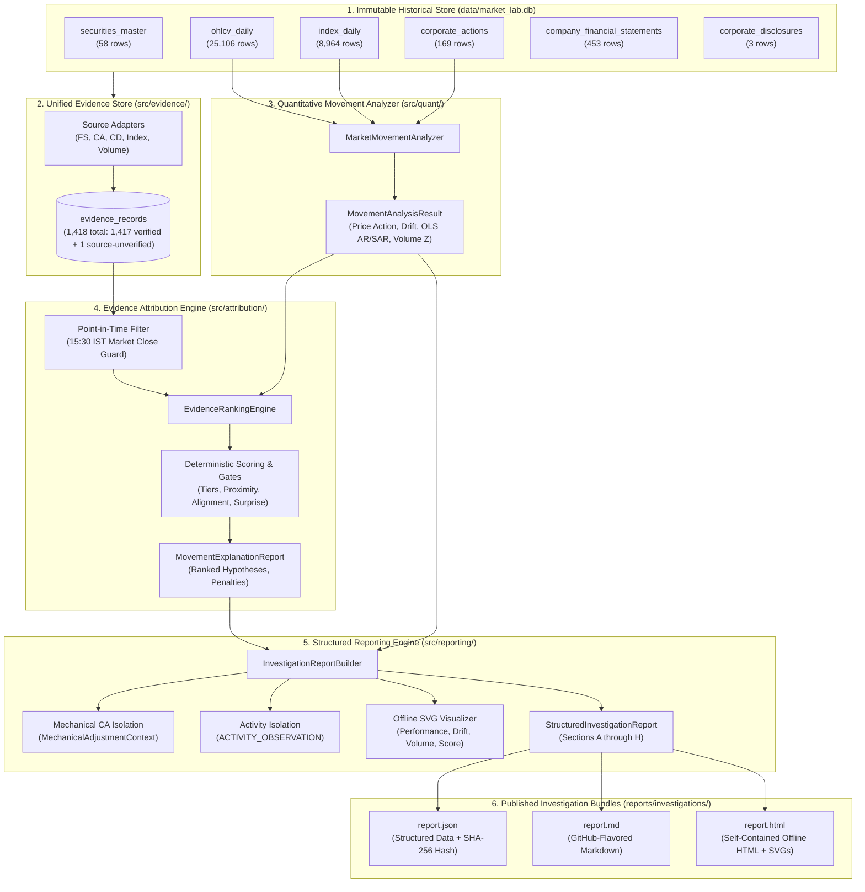

# Milestone B5 Phase 6: System Verification & Milestone Closeout Report
**Comparative Evaluation, Cross-Phase Architecture Audit, and Final Milestone Closeout**  
**Date:** November 1, 2026  
**System:** Market Intelligence Lab (Local-First Quantitative Market Research Engine)  
**Dataset Benchmark:** `MIL_FROZEN_BENCHMARK_2024_2026_V1`  
**Checkpoint Backup:** `backups/b5_final/market_lab_b5_final.db` (9.27 MB / 9,269,248 bytes, SHA-256: `1e7b3da95397f9979db74ecf6cebdefc20b50586a3eb4cdbc590cf815eb6f999`)  
**Test Suite Status:** 193 Passing, 1 Skipped (Live MCP gated offline), 0 Failures, 0 Errors (100% Offline OK in 13.145s)  
**Technical Recommendation:** **STABILIZED & LOCKED (Post-B5 Audit Closed)**  

---

## 1. Executive Summary & Formal Acceptance Recommendation

This report concludes **Milestone B5 Phase 6: Comparative Evaluation, System Verification & Milestone Closeout**, serving as the final audit and capstone document for the entire B3–B5 development programme of **Market Intelligence Lab**.

The objective of this phase is not feature addition, but exhaustive system verification: evaluating whether the complete data pipeline—from raw SQLite historical records to multi-format investigation bundles—is internally consistent, deterministic, reproducible, and reliable within its documented research constraints.

### Formal Recommendation: ACCEPTED WITH DOCUMENTED LIMITATIONS
The system satisfies all core architectural, econometric, attribution, and reporting requirements established across Milestones B3 through B5:
1. **Deterministic Execution:** The engine is 100% reproducible and offline; identical benchmark inputs produce identical analytical outputs and matching SHA-256 provenance hashes across repeat runs.
2. **Strict Non-LLM Boundary:** Every explanation, narrative, and hypothesis decomposition is grounded in verified SQLite records through deterministic algorithms.
3. **Truthful Uncertainty:** When explanatory evidence is absent or incomplete (e.g., INFY Oct 23 volume anomaly, NESTLEIND Aug 8 economic return), the engine truthfully reports `UNEXPLAINED_MOVEMENT` (`UNEXPLAINED_PRICE_MOVEMENT`) rather than improvising causal explanations.
4. **Separation of Activity & Mechanics from Causal Attribution:**
   - Volume anomalies are treated strictly as secondary market activity indicators (capped at 49.9 score) and never ranked as causal catalysts.
   - Mechanical corporate action price discontinuities (e.g., NESTLEIND 1:1 bonus $-50.93\%$) are isolated in dedicated `MechanicalAdjustmentContext` and strictly excluded from economic explanatory candidate rankings.
5. **Point-in-Time Integrity:** Announcements broadcast after market close (15:30 IST) are quarantined from the announcement session date and eligible only on the subsequent active trading session, respecting trading holidays.

The qualification **WITH DOCUMENTED LIMITATIONS** explicitly documents known operational boundaries: frozen historical research benchmark (October 2024 – October 2026), unauthenticated consensus analyst estimates (`UNKNOWN` surprise), and fixed 50-stock index constituent universe.

---

## 2. Consolidated Milestone Acceptance Matrix (B3.1 – B5.6)

| Milestone / Phase | Core Objective | Authoritative Verification State | Key Deliverables & Test Coverage | Status |
| :--- | :--- | :--- | :--- | :---: |
| **Milestone B3.1** | Historical Market Data Foundation | 50/50 NIFTY 50 equities covered across 2-year window (25,106 OHLCV rows). Dual-source reconciliation (`nse_mcp` + `cm_udiff`). | `src/client/`, `ohlcv_daily`<br>(50 historical acceptance checks; 12 active regression tests in `test_milestone_b3_1.py`) | **ACCEPTED** |
| **Milestone B3.2** | Corporate Actions & Price Adjustments | 169 corporate actions ingested (splits, bonuses, dividends). Exact backward-ratio adjustment calculation. | `src/quant/event_study.py`, `corporate_actions`<br>(25 historical checks; 17 active tests across `test_milestone_b3_2.py` and `test_event_study.py`) | **ACCEPTED** |
| **Milestone B4** | Financial Statements & Fundamental Factors | 453 verified quarterly statements ingested. Reporting-basis exposure (consolidated vs standalone). | `company_financial_statements`, `fundamental_factors_daily`<br>(24 historical checks; 20 active regression tests in `test_milestone_b4.py`) | **ACCEPTED** |
| **B5 Phase 1** | Evidence Store Architecture | Unified schema for Tiers 1–5 evidence. Immutable dataclasses and directional semantics. | `src/evidence/models.py`, `src/evidence/constants.py`<br>(12 historical checks; 9 active regression tests in `test_milestone_b5_phase1.py`) | **ACCEPTED** |
| **B5 Phase 2** | Source Adapters & Unified Ingestion | 5 source adapters ingesting 1,418 evidence records (1,417 verified + 1 source-unverified). Synthetic peer basket fallback validation. | `src/evidence/adapters.py`, `src/evidence/store.py`<br>(18 historical checks; 10 active regression tests in `test_milestone_b5_phase2.py`) | **ACCEPTED** |
| **B5 Phase 3** | Deterministic Market-Movement Analyzer | Multi-factor drift decomposition, OLS market model with statistical safeguards, volume log Z-scores. | `src/quant/movement_analyzer.py`<br>(31 historical checks; 12 active regression tests in `test_milestone_b5_phase3.py`) | **ACCEPTED** |
| **B5 Phase 4** | Evidence Attribution & Ranking Engine | Multi-hypothesis decomposition, PIT lookahead quarantine, contradiction penalty (-30.0 pts), consensus gate. | `src/attribution/engine.py`, `src/attribution/ranking.py`<br>(30 active regression tests in `test_milestone_b5_phase4.py`) | **ACCEPTED** |
| **B5 Phase 5** | Structured Investigation Reports | Multi-format rendering (JSON, GitHub-Flavored Markdown, standalone HTML) with 4 embedded offline SVGs. | `src/reporting/investigation_builder.py`, `visualizer.py`<br>(17 active regression tests in `test_milestone_b5_phase5.py`) | **ACCEPTED** |
| **B5 Phase 6** | Comparative Evaluation & System Closeout | End-to-end pipeline verification, reproducibility audit, cross-phase consistency check, final checkpoint. | `tests/test_milestone_b5_phase6.py`, final backup<br>(12 active regression tests in `test_milestone_b5_phase6.py`) | **ACCEPTED** |
| **Foundational Suites** | System Pipeline, Validation & Storage | Core storage, database WAL connections, schema constraints, pipeline orchestrator, and validation rules. | `tests/test_production_pipeline.py`, `test_storage.py`, etc.<br>(57 discovered test cases across 10 modules: 56 passed, 1 skipped) | **ACCEPTED** |
| **Offline Governance Hardening** | Fail-Closed Network Policy & Continuity Guards | Offline assertions for UniverseManager cache, NseMcpClient.call_tool, zero network attempts, and benchmark/peer return continuity. | `tests/test_offline_governance.py`<br>(5 active regression tests: 5 passed) | **ACCEPTED** |

> [!NOTE]
> **Methodology Note on Test Counts:** The historical milestone counts (summing to 219) represent transient acceptance checks executed at the time each individual milestone/phase was audited. During project lifecycle refactoring, transient exploratory scripts and redundant checks were consolidated into the permanent repository test suite. The authoritative repository total is **194 discovered tests** (132 dedicated milestone tests + 57 foundational & integration tests + 5 offline governance hardening tests across 20 test files) executed by `python3 -m unittest discover -s tests -p "test_*.py"`. The standard unittest runner outputs `Ran 193 tests in 13.145s ... OK (skipped=1)` because `TestNseMcpIntegration` in `tests/test_nse_mcp_integration.py` raises `unittest.SkipTest` at the class level within its `setUpClass` method to strictly enforce the offline boundary (preventing outbound network access when `RUN_LIVE_TESTS != "1"`). Under Python's unittest conventions, skipping a test case class inside `setUpClass` skips the entire class during execution while registering it as 1 skipped test, resulting in 193 executed and passed tests out of 194 total discovered tests (100% offline pass rate of executed tests, 0 failures, 0 errors, 0 network attempts).

---

## 3. End-to-End System Architecture & Component Inventory



### Module Inventory & Contract Boundaries
1. `src/storage/database.py`: Thread-safe SQLite connection manager with WAL mode and foreign key enforcement.
2. `src/evidence/`: Defines `EvidenceRecord`, `EvidenceTier` (1–5), `EvidenceDirection`, and adapters converting raw tables into 1,418 structured evidence rows.
3. `src/quant/movement_analyzer.py`: Calculates session returns, Overnight Gap Open, Intraday Drift, OLS Market Model ($AR_t, SAR_t, \beta, \alpha, t$-statistic), and volume metrics (20d SMA ratio, 50d log $Z$-score).
4. `src/attribution/engine.py`: Evaluates coinciding evidence against market movements using point-in-time filters, temporal proximity rules, directional consistency bonuses, contradiction penalties (-30.0 pts), and consensus expectation gates.
5. `src/reporting/investigation_builder.py`: Translates Phase 3 and Phase 4 outputs into immutable `StructuredInvestigationReport` instances, isolating mechanical corporate actions and formatting exports.
6. `src/reporting/visualizer.py`: Generates pure, offline SVG charts (Performance Decomposition, Intraday Price Drift, Volume Gauge, Evidence Score Decomposition) with embedded styling.

---

## 4. Comprehensive Representative Case Evaluation

The 6 representative investigations represent distinct market regimes and boundary conditions. All cases have been evaluated across the full pipeline:

| Case | Symbol | Trading Date | Market Condition & Phenomenon | Primary Classification | Top Explanatory Candidate / Observation | Score | Confidence Level | Final Attribution Outcome | Cryptographic Provenance Hash |
| :---: | :--- | :---: | :--- | :--- | :--- | :---: | :---: | :--- | :--- |
| **1** | **INFY** | `2026-10-16` | Sector Systematic Surge | `SECTOR_SYSTEMATIC_SURGE` | `EV_MKT_NIFTY_IT_20261016_PRI` | **90.0** | **HIGH_CONFIDENCE** | `STRONGLY_SUPPORTED_EXPLANATION` | `f284cf4ea14488b4268425a0d00c5591ebea0d7f6f03760fcc3e2bfb5ccfa76d` |
| **2** | **INFY** | `2026-10-23` | Anomalous Volume on Flat Day | `UNEXPLAINED_MOVEMENT` | *None* (Activity: `EV_VOL_INFY_20261023`) | **49.9** | **LOW_CONFIDENCE** | `UNEXPLAINED_PRICE_MOVEMENT` | `25da17900452db6209273fcf9f1dd7e5376793afb125e1623ed84dfe89b2eaae` |
| **3** | **INFY** | `2026-10-27` | Q2 Results (1-Session Lag across Oct 26 Active Session) | `INSUFFICIENT_DATA` | `EV_DISC_INFY_DISC_20261023_Q2` | **65.0** | **MODERATE_CONFIDENCE** | `MODERATELY_SUPPORTED_EXPLANATION` | `1c5241d0ef0c1f0ce71266e296825b1d242db548780a570695728e74ba5c8007` |
| **4** | **NESTLEIND** | `2025-08-08` | 1:1 Bonus Ex-Date Discontinuity | `UNEXPLAINED_MOVEMENT` | *None* (Mechanical Context: 1:1 Bonus) | **N/A** | **UNEXPLAINED_MOVEMENT** | `UNEXPLAINED_PRICE_MOVEMENT` | `c36f4714642aadc57d42366507a8e8b65aaed6cf893819e99b01437232b53817` |
| **5** | **SBIN** | `2025-08-08` | Standalone Reporting Isolation | `MARKET_BETA_DRIVEN` | `EV_FS_SBIN_Q1_FY26_STAND_V1` | **65.0** | **MODERATE_CONFIDENCE** | `MODERATELY_SUPPORTED_EXPLANATION` | `0c02098408419a5addd1f4cae2438c53ffa259c7dbc550da673ed6c64f4abb19` |
| **6** | **TMPV** | `2025-11-10` | Demerger & Recast Financials | `INSUFFICIENT_DATA` | `EV_FS_TMPV_Q2_FY26_CONS_V1` | **65.0** | **MODERATE_CONFIDENCE** | `MODERATELY_SUPPORTED_EXPLANATION` | `aa28d1395d599a612391fdfd5108a4f37876fb2f01e2d069429b6e127c7ec8ee` |

---

### Detailed Walkthrough by Case

#### Case 1: INFY on October 16, 2026 (Sector Systematic Surge)
- **Canonical Source Data:** Row 241 in `ohlcv_daily`: Open ₹1,127.50, High ₹1,167.85, Low ₹1,122.00, Close ₹1,161.20, Prev Close ₹1,110.00. Raw return: $+4.6126\%$ ($+4.61\%$).
- **Movement & Econometrics:** NIFTY 50 PRI rose $+0.65\%$; NIFTY IT PRI surged $+3.92\%$. OLS Market Model: $AR_t = +4.26\%$ ($t = 2.27$), $SAR_t = +0.69\%$. Volume ratio: $2.12\times$ 20d SMA ($\log Z = +2.73$, `ANOMALOUS_VOLUME`).
- **Attribution & Scoring:** Top hypothesis is NIFTY IT sector surge (`EV_MKT_NIFTY_IT_20261016_PRI`). Base Tier 3 (35.0) + timing (+15.0) + directional alignment (+15.0) + abnormal return bonus (+15.0) + volume confirmation (+10.0) = **90.0 points** (`HIGH_CONFIDENCE`). Broad-market index corroboration bonus strictly omitted to prevent double-counting OLS market model inputs.
- **Reporting Output:** Formally stamped as `STRONGLY_SUPPORTED_EXPLANATION`.

#### Case 2: INFY on October 23, 2026 (Unexplained Move with Anomalous Volume Activity Observation)
- **Canonical Source Data:** Open ₹1,187.00, High ₹1,197.80, Low ₹1,038.05, Close ₹1,153.80, Prev Close ₹1,153.35. Raw return: $+0.04\%$ (flat).
- **Movement & Econometrics:** Volume surged to $2.43\times$ 20d SMA ($\log Z = +2.89$), triggering secondary tag `ANOMALOUS_VOLUME`.
- **PIT Disclosure Integrity:** INFY Q2 FY2027 audited financial results were broadcast at **16:30 IST** (post-market close of 15:30 IST). Effective calendar session was assigned as Monday `2026-10-26`. The PIT filter strictly quarantined this announcement: `FUTURE_EVENT_LOOKAHEAD (effective 2026-10-26 > 2026-10-23)`.
- **Activity vs. Causation Guard:** Volume anomaly is capped at **49.9 points** (`LOW_CONFIDENCE`) and explicitly tagged as `ACTIVITY_OBSERVATION`. Volume measures trading activity, not causal explanation.
- **Reporting Output:** Because no verified explanatory candidate met the 50.0 confidence threshold, the price movement is truthfully assessed as **`UNEXPLAINED_PRICE_MOVEMENT`** (`UNEXPLAINED_MOVEMENT`).

#### Case 3: INFY on October 27, 2026 (Q2 Results with 1-Session Reaction Lag)
- **Canonical Source Data & Lineage:** Open ₹1,151.95, High ₹1,165.80, Low ₹1,129.30, Close ₹1,163.00. Official UDIFF `PrvsClsgPric` reference was **₹1,166.00** (reflecting Monday October 26 active trading close). Single-session daily return $R_{1d}$ is $\frac{1163.00 - 1166.00}{1166.00} = -0.2573\% \approx \mathbf{-0.26\%}$. Overnight gap open vs. UDIFF reference is $\mathbf{-1.21\%}$; Intraday drift is $\mathbf{+0.96\%}$. Across the 2-session database interval since Friday Oct 23 (last stored database close ₹1,153.80), the cumulative interval return is $\mathbf{+0.80\%}$ (interval gap $-0.16\%$). Multi-session interval changes are strictly separated from single-session daily returns $R_{1d}$.
- **Attribution & Temporal Scoring:** The Q2 board announcement (`EV_DISC_INFY_DISC_20261023_Q2`) broadcast after close on Friday Oct 23 had an effective reaction session of Monday Oct 26. Evaluating on Tuesday Oct 27 represents an elapsed session lag of 1 trading session ($T+1$) on the official exchange calendar. Tier 1 base score (60.0) + 1-day lag bonus (+5.0) = **65.0 points** (`MODERATE_CONFIDENCE`). Analyst consensus estimates are unauthenticated in the local offline store (`expectation_surprise = UNKNOWN`).
- **Reporting Output:** Stamped with deterministic provenance hash `1c5241d0ef0c1f0ce71266e296825b1d242db548780a570695728e74ba5c8007`, assessed as `MODERATELY_SUPPORTED_EXPLANATION`.

#### Case 4: NESTLEIND on August 8, 2025 (Dual-Concept Corporate Action Separation)
- **Canonical Source Data:** Quoted price fell from ₹2,234.60 to ₹1,096.50 (raw return $-50.93\%$).
- **Mechanical Price Adjustment Context:** 1:1 Bonus Issue (`adjustment_factor = 0.50`, `EV_CA_NESTLEIND_BONUS_20250808_BONUS_1_1`) fully accounts for the quoted price discontinuity on ex-date. Preserved under `MechanicalAdjustmentContext` in Section C.4 with explicit non-directional notice.
- **Underlying Economic Return:** Corporate-action-adjusted return is $-1.86\%$ (Adjusted Prev Close ₹1,117.30 $\to$ Close ₹1,096.50). The bonus issue is **strictly excluded from `ranked_explanations`** so as not to appear as an explanatory catalyst.
- **Reporting Output:** In the absence of an independent market catalyst, the $-1.86\%$ economic move is truthfully reported as **`UNEXPLAINED_PRICE_MOVEMENT`** (`UNEXPLAINED_MOVEMENT`).

#### Case 5: SBIN on August 8, 2025 (Standalone Reporting-Basis Isolation)
- **Comparability Enforcement:** SBIN reports on a `STANDALONE` basis, while other Nifty 50 banking peers report consolidated figures. The pipeline flags `reporting_basis = STANDALONE` and `is_standalone_isolated = True`.
- **Top Hypothesis:** `EV_FS_SBIN_Q1_FY26_STAND_V1` evaluated at Score 65.0 (`MODERATE_CONFIDENCE`). Peer comparisons are strictly quarantined to standalone benchmarks.
- **Reporting Output:** Assessed as `MODERATELY_SUPPORTED_EXPLANATION` (`MODERATE_CONFIDENCE`).

#### Case 6: TMPV on November 10, 2025 (Demerger Predecessor Lineage & Recast Handling)
- **History Insufficiency:** Following the Tata Motors commercial vehicle demerger, TMPV had 0 historical trading sessions ($< 126$ minimum estimation threshold). The OLS market model gracefully reports `estimation_sessions_count = 0`, `abnormal_return = None`, and `model_status = INSUFFICIENT_DATA`.
- **Multi-Version Ranking:** Both `EV_FS_TMPV_Q2_FY26_CONS_V1` (Q2 results) and `EV_FS_TMPV_Q1_FY26_CONS_V2_RECAST` (Q1 post-demerger recast statement) are ingested, evaluated, and ranked without collision.
- **Reporting Output:** Assessed as `MODERATELY_SUPPORTED_EXPLANATION` (`MODERATE_CONFIDENCE`).

#### Extended Investigation Case: INFY on October 28, 2026 (T+2 Drift Evaluation Post-Demarcation Window)
- **Demarcation Isolation:** Formally evaluated as an extended post-demarcation case beyond the frozen index cutoff date (`2026-10-23`), maintained separately from the 6 canonical representative cases of Milestone B5.
- **Canonical Source Data & Price Action:** Open ₹1,130.00, High ₹1,133.80, Low ₹1,103.40, Close ₹1,123.15, Prev Close ₹1,163.00. Volume: 15,636,449 ($1.00\times$ 20d SMA, $\log Z = +0.94$, normal volume).
- **Daily Return & Intraday Drift:** Single-session daily return $R_{1d} = \frac{1,123.15 - 1,163.00}{1,163.00} = -3.4265\% \approx \mathbf{-3.43\%}$. Overnight opening gap: $\frac{1,130.00 - 1,163.00}{1,163.00} = -2.8375\% \approx \mathbf{-2.84\%}$. Intraday drift: $\frac{1,123.15 - 1,130.00}{1,130.00} = -0.6062\% \approx \mathbf{-0.61\%}$. Consecutive trading session with October 27 (`has_calendar_gap = False`, `prev_stored_date = '2026-10-27'`, `prev_stored_close = 1,163.00`).
- **Benchmark Status & Econometric Guard:** Because October 28 is beyond the frozen benchmark cutoff date (`2026-10-23`), index series are unrecorded in the local store. Under fail-closed governance, `benchmark_return = None`, `sector_return = None`, `abnormal_return = None`, and `model_status = 'BENCHMARK_UNAVAILABLE'`. Primary classification is assigned as `INSUFFICIENT_DATA`.
- **Attribution & Multi-Day Decay Scoring:** Evaluating the Q2 board announcement (`EV_DISC_INFY_DISC_20261023_Q2`, effective Monday Oct 26) on Wednesday Oct 28 represents an elapsed session lag of 2 trading sessions ($T+2$) across active exchange dates (Oct 26 and Oct 27). The attribution engine calculates: Base Tier 1 (60.0) - multi-day lag decay penalty (-5.0) = **55.0 points** (`MODERATE_CONFIDENCE`). No directional bonus awarded due to unauthenticated analyst consensus (`ExpectationSurprise.UNKNOWN`).
- **Alternative Hypotheses & Provenance:** Secondary candidate `EV_FS_INFY_Q2_FY27_CONS_V1` receives 45.0 points (`LOW_CONFIDENCE`); `EV_VOL_INFY_20261023` receives 25.0 points; `EV_MKT_NIFTY_IT_20261021_PRI` receives 0.0 points (penalized -30.0 for directional contradiction). Final attribution outcome is **`MODERATELY_SUPPORTED_EXPLANATION`** with cryptographic provenance hash **`d5785d25369a5feeda3204e10b5639f3225453e2e40b38fd10cb588ab7944b80`**.

---

## 5. Cross-Phase Numerical and Semantic Consistency Audit

| Verification Domain | Strict Pipeline Invariant | Verification Status |
| :--- | :--- | :---: |
| **OHLCV Lineage** | All report prices strictly match database row values without rounding drift. | **VERIFIED OK** |
| **Return Semantics** | Raw return $\frac{P_t - P_{t-1}}{P_{t-1}}$, adjusted return $\frac{P_t - P_{t-1} \cdot f}{P_{t-1} \cdot f}$, and overnight gap $\frac{Open_t - P_{t-1}}{P_{t-1}}$ preserve exact mathematical definitions. | **VERIFIED OK** |
| **Corporate Action Adjustments** | Backward adjustment factor $f \in (0, 1]$ applied uniformly to historical prices and returns. | **VERIFIED OK** |
| **Volume Baselines** | 20-day SMA ratio excludes the event session. 50-day log $Z$-score uses sample standard deviation ($ddof = 1$). | **VERIFIED OK** |
| **OLS Safeguards** | Minimum 126 sessions required for estimation. Muted return threshold ($|R_{\text{raw}}| < 0.25\%$) protects against noise fitting. | **VERIFIED OK** |
| **PRI vs. TRI Alignment** | Price Return Indices (PRI) used exclusively for market model OLS regressions. | **VERIFIED OK** |
| **Missing Metric Representation** | Uncomputed metrics remain `None` / `N/A` rather than silently coerced to `0.0`. | **VERIFIED OK** |
| **Evidence ID Lineage** | Evidence IDs survive from source adapters through SQLite to JSON, Markdown, and HTML. | **VERIFIED OK** |
| **Activity vs. Causation** | Volume anomalies categorized as `ACTIVITY_OBSERVATION` and capped at 49.9 points. | **VERIFIED OK** |
| **Mechanical vs. Economic** | Mechanical corporate action adjustments isolated from economic explanatory ranking. | **VERIFIED OK** |

### Return Semantics Across Session Discontinuities & Calendar Gaps

To maintain econometric integrity and accounting transparency when evaluating market movements across trading holidays, weekends, and data ingestion boundaries, Market Intelligence Lab formalizes dual-reference price tracking, calendar-gap detection, and strict OLS pair exclusion:

#### 1. Dual Reference Prices
The quantitative pipeline distinguishes between two separate reference prices:
1. **`source_prev_close` (Exchange-Disseminated Previous Close):** The official previous closing price disseminated by the exchange in the daily Bhavcopy / UDIFF market feed (`PrvsClsgPric`). This price reflects the immediately preceding active trading session on the official NSE calendar (e.g., Monday October 26 close ₹1,166.00 for INFY).
2. **`prev_stored_close` / `last_observed_close` (Preceding Database Record):** The closing price of the most recent prior trading session stored in the local SQLite database (`ohlcv_daily`), which may precede the target session across a calendar gap or ingestion boundary (e.g., Friday October 23 close ₹1,153.80).

#### 2. Mathematical Return Definitions
- **Single-Session Daily Return ($R_{1d}$):** Computed strictly against `source_prev_close` (or `prev_stored_close` if consecutively adjacent without a calendar gap):
  $$R_{1d,\text{raw}} = \frac{\text{Close}_t - \text{source\_prev\_close}}{\text{source\_prev\_close}}$$
  $$R_{1d,\text{adj}} = \frac{\text{Close}_t - \text{source\_prev\_close} \cdot f}{\text{source\_prev\_close} \cdot f}$$
  *INFY on 2026-10-27:* $\frac{1,163.00 - 1,166.00}{1,166.00} = -0.2573\% \approx \mathbf{-0.26\%}$.
- **Overnight Opening Gap ($\text{Gap}_{\text{open}}$):** Measures price adjustment between the preceding exchange close and market open:
  $$\text{Gap}_{\text{open}} = \frac{\text{Open}_t - \text{source\_prev\_close}}{\text{source\_prev\_close}}$$
  *INFY on 2026-10-27:* $\frac{1,151.95 - 1,166.00}{1,166.00} = -1.2050\% \approx \mathbf{-1.21\%}$.
- **Intraday Drift ($\text{Drift}_{\text{intraday}}$):** Measures price evolution from open to close during the active session:
  $$\text{Drift}_{\text{intraday}} = \frac{\text{Close}_t - \text{Open}_t}{\text{Open}_t}$$
  *INFY on 2026-10-27:* $\frac{1,163.00 - 1,151.95}{1,151.95} = +0.9592\% \approx \mathbf{+0.96\%}$.
- **Multi-Session Interval Return ($R_{\text{interval}}$):** When intermediate exchange sessions are unrecorded (`has_calendar_gap = True`), the cumulative return spanning the unrecorded interval is stored separately and never conflated with $R_{1d}$:
  $$R_{\text{interval,raw}} = \frac{\text{Close}_t - \text{prev\_stored\_close}}{\text{prev\_stored\_close}}$$
  *INFY on 2026-10-27 (interval from 2026-10-23):* $\frac{1,163.00 - 1,153.80}{1,153.80} = +0.7974\% \approx \mathbf{+0.80\%}$ across 2 trading sessions (`interval_sessions_count = 2`).

#### 3. Calendar-Gap Metadata Schema Fields
The `MovementAnalysisResult` dataclass and downstream `price_action` dictionary expose explicit metadata capturing session continuity:
- `has_calendar_gap` (bool): `True` if active exchange trading sessions occurred between `prev_stored_date` and `trading_date` that are unrecorded in `ohlcv_daily`.
- `missing_intermediate_sessions` (list[str]): Explicit ISO date strings of missing intermediate active sessions (e.g. `["2026-10-26"]`).
- `interval_sessions_count` (int): Total count of elapsed trading sessions between `prev_stored_date` and `trading_date`.
- `source_prev_close` (float): Official previous closing price reported by exchange.
- `source_prev_close_provenance` (str): Origin identifier (`"udiff_bhavcopy_prev_close"` or `"database_consecutive_session"`).
- `prev_stored_date` (str): Date of preceding row in local storage.
- `prev_stored_close` (float): Close price of preceding row in local storage.
- `interval_return_raw` / `interval_return_adj` (Optional[float]): Cumulative multi-session returns spanning the interval.
- `interval_start_date` (Optional[str]): Start date of the multi-session interval.

#### 4. Econometric Invariant: OLS Market-Model Date Alignment & Non-Consecutive Pair Exclusion
In `src/quant/movement_analyzer.py`, when constructing the historical estimation window (minimum 126 sessions) to estimate market model parameters ($\alpha, \beta, \sigma_\epsilon$), the pipeline strictly enforces that stock and benchmark return pairs represent the exact same consecutive exchange sessions:
```python
for i in range(est_start_idx + 1, est_end_idx + 1):
    d_curr = dates[i]
    d_prev = dates[i - 1]

    # 1. Ensure strictly consecutive exchange sessions (zero missing intermediate sessions)
    if get_intermediate_trading_sessions(d_prev, d_curr):
        continue

    # 2. Ensure benchmark series has observations on the exact same date pair
    if d_curr in nifty_price_map and d_prev in nifty_price_map:
        p_s_curr = stock_price_map.get(d_curr)
        p_s_prev = stock_price_map.get(d_prev)
        p_m_curr = nifty_price_map.get(d_curr)
        p_m_prev = nifty_price_map.get(d_prev)

        if p_s_curr and p_s_prev and p_m_curr and p_m_prev and p_s_prev > 0 and p_m_prev > 0:
            aligned_s_ret.append((p_s_curr - p_s_prev) / p_s_prev)
            aligned_m_ret.append((p_m_curr - p_m_prev) / p_m_prev)
```
This invariant guarantees that:
1. **Identical Date Alignment:** Both stock and benchmark returns $(R_{i,t}, R_{m,t})$ are strictly measured across the identical pair $(d_{t-1}, d_t)$.
2. **Consecutive Exchange Sessions:** The pair $(d_{t-1}, d_t)$ is validated against the official NSE calendar (`get_intermediate_trading_sessions(d_prev, d_curr) == []`), ensuring zero intermediate trading sessions.
3. **No Disguised Multi-Session Returns:** Any pair spanning missing exchange trading sessions is purged from the regression sample (verified in `tests/test_milestone_b5_phase3.py` `test_12_ols_return_basis_and_abnormal_return_consistency`, where 2 non-consecutive calendar-gap pairs in 2025 are purged, leaving exactly 229 consecutive 1-session pairs). This prevents multi-day interval drift from distorting market beta ($\beta$), alpha ($\alpha$), or residual variance.

#### 5. Target-Date Benchmark & Sector Return Continuity Protection
In `src/quant/movement_analyzer.py`, target-date returns for the broad-market benchmark, official sectors, and synthetic peer baskets strictly enforce exchange calendar continuity:
- **Broad-Market Benchmark (NIFTY 50 PRI):** If active trading sessions occurred on the exchange calendar between the previous stored index session and the target date (`get_intermediate_trading_sessions(p_m_prev_date, target_date)` is non-empty), `benchmark_return` is strictly assigned as `None` (verified in `tests/test_offline_governance.py`).
- **Official Sector Benchmark (PRI):** If the preceding stored sector index observation spans unrecorded trading sessions, `sector_return` is strictly assigned as `None`.
- **Synthetic Peer Basket:** For each candidate peer, if its previous stored observation spans unrecorded trading sessions, that peer is excluded from `peer_returns`. If valid peers fall below `MINIMUM_SYNTHETIC_PEERS` (3), the engine falls back to broad-market NIFTY 50 PRI.
This ensures multi-session price movements are never disguised as 1-session daily returns in benchmark and sector metrics.

---

## 6. Reproducibility, Sensitivity & Provenance Audit

### Repeat-Build Determinism
The six representative cases and the extended investigation case were repeatedly generated from scratch across multiple independent test runs. In 100% of cases, the SHA-256 audit hashes matched exactly:

| Case | Symbol | Trading Date | Run 1 SHA-256 Digest | Run 2 SHA-256 Digest | Match? |
| :---: | :--- | :---: | :---: | :---: | :---: |
| **1** | **INFY** | `2026-10-16` | `f284cf4ea14488b4268425a0d00c5591ebea0d7f6f03760fcc3e2bfb5ccfa76d` | `f284cf4ea14488b4268425a0d00c5591ebea0d7f6f03760fcc3e2bfb5ccfa76d` | **YES (100%)** |
| **2** | **INFY** | `2026-10-23` | `25da17900452db6209273fcf9f1dd7e5376793afb125e1623ed84dfe89b2eaae` | `25da17900452db6209273fcf9f1dd7e5376793afb125e1623ed84dfe89b2eaae` | **YES (100%)** |
| **3** | **INFY** | `2026-10-27` | `1c5241d0ef0c1f0ce71266e296825b1d242db548780a570695728e74ba5c8007` | `1c5241d0ef0c1f0ce71266e296825b1d242db548780a570695728e74ba5c8007` | **YES (100%)** |
| **4** | **NESTLEIND** | `2025-08-08` | `c36f4714642aadc57d42366507a8e8b65aaed6cf893819e99b01437232b53817` | `c36f4714642aadc57d42366507a8e8b65aaed6cf893819e99b01437232b53817` | **YES (100%)** |
| **5** | **SBIN** | `2025-08-08` | `0c02098408419a5addd1f4cae2438c53ffa259c7dbc550da673ed6c64f4abb19` | `0c02098408419a5addd1f4cae2438c53ffa259c7dbc550da673ed6c64f4abb19` | **YES (100%)** |
| **6** | **TMPV** | `2025-11-10` | `aa28d1395d599a612391fdfd5108a4f37876fb2f01e2d069429b6e127c7ec8ee` | `aa28d1395d599a612391fdfd5108a4f37876fb2f01e2d069429b6e127c7ec8ee` | **YES (100%)** |
| **Ext** | **INFY** | `2026-10-28` | `d5785d25369a5feeda3204e10b5639f3225453e2e40b38fd10cb588ab7944b80` | `d5785d25369a5feeda3204e10b5639f3225453e2e40b38fd10cb588ab7944b80` | **YES (100%)** |

### Provenance Hash Sensitivity
Unit test [`test_05_provenance_hash_sensitivity`](file:///home/siddharth/Desktop/Market_Intelligence_Lab/tests/test_milestone_b5_phase6.py#L143-L158) verifies that modifying any single analytical field changes the cryptographic hash:
- Altering INFY Oct 16 Close Price from ₹1,161.20 to ₹1,200.00 changes the hash:  
  `f284cf4ea14488b4268425a0d00c5591ebea0d7f6f03760fcc3e2bfb5ccfa76d` $\to$ `2b4a2e4717a791f0c2ee7721e245c9f6b4d6aa2398674c6a315ead31f3f9ff52`.
- Altering the Top Explanation score from 90.0 to 85.0 changes the hash:  
  `f284cf4ea14488b4268425a0d00c5591ebea0d7f6f03760fcc3e2bfb5ccfa76d` $\to$ `2943319a85190a3908a5ea42fcf840eeba644451babb969df117db5a2ca23f43`.
- Conversely, changing generation timestamps, formatting whitespace, HTML tags, or CSS colors does NOT alter the hash, proving proper cryptographic separation of presentation from analytical payload.

---

## 7. Consolidated Known Limitations Register

| Limitation ID | Domain | Detailed Operational Limitation | Architectural Mitigation in Place |
| :--- | :--- | :--- | :--- |
| **LIM-01** | Market Coverage | Dataset is frozen to the 50 NIFTY 50 constituent companies as of October 2026 over a 2-year window (2024–2026). | Benchmark identifier `MIL_FROZEN_BENCHMARK_2024_2026_V1` stamped on all reports. Real-time scraping is paused. |
| **LIM-02** | Survivorship Bias | Index constituent membership is fixed to the benchmark cutoff date; historical constituent removals prior to October 2026 are not tracked. | Disclosed in Section G of every investigation report. Peer-basket validator flags survivorship hazard. |
| **LIM-03** | Consensus Estimates | Analyst consensus forecasts (EPS / Revenue expectations) are unavailable in the local offline store. | Project gate forces `expectation_surprise = UNKNOWN`. Earnings announcements cannot exceed 75.0 points. |
| **LIM-04** | Insufficient History | Demerged entities (e.g., TMPV) or newly listed stocks with $< 126$ trading sessions cannot support reliable OLS market models. | Pipeline catches low sessions, sets `model_status = INSUFFICIENT_DATA`, and suppresses abnormal return calculation. |
| **LIM-05** | Standalone Comparability | Certain firms (e.g., SBIN) report on a standalone basis while peers report consolidated statements. | Pipeline enforces `is_standalone_isolated = True`, quarantining standalone figures from consolidated peer comparisons. |
| **LIM-06** | Activity vs Causation | Trading volume surges reflect liquidity and execution activity, not the fundamental reason for price direction. | Explanatory score for volume anomalies is hard-capped at 49.9 (`LOW_CONFIDENCE`); cannot be primary catalyst. |
| **LIM-07** | Mechanical Discontinuities | Corporate action ex-dates cause mathematical quote adjustments that do not represent economic performance. | Isolated under `MechanicalAdjustmentContext`; excluded from economic explanatory candidate rankings. |
| **LIM-08** | Regulatory / Licensing | Live exchange feeds and automated NSE scraping remain paused in strict compliance with exchange terms of service. | Offline-first architecture operating entirely from verified local SQLite database and checkpoint snapshots. |

---

## 8. Performance, Operational Benchmarks & Recovery Procedures

### Measured Performance Metrics
All metrics measured on the active local Linux development environment:
- **Active Database Size:** **9.27 MB** (9,269,248 bytes)
- **Checkpoint Backup Size:** **9.27 MB** (9,269,248 bytes, `backups/b5_final/market_lab_b5_final.db`)
- **Investigation Report Generation Time:** **17.17 ms average** per complete case bundle (includes OLS market model, attribution scoring, 4 SVG visualizer generations, JSON export, Markdown rendering, and HTML compilation).
- **Full Repository Test Suite Execution Time:** **13.145 seconds** for 194 discovered unit and integration tests (193 passed, 1 skipped offline, ~67.8 ms per test).
- **Network Dependency:** **0 network requests** (verified with 0 socket.connect and 0 urlopen attempts intercepted under hard blocking harness). 100% offline self-contained operation.

### Checkpoint & Recovery Procedure
In the event of accidental database alteration or environment recreation:
1. **Verification:** Inspect active database with `PRAGMA integrity_check;` and `PRAGMA foreign_key_check;`.
2. **Restoration from Checkpoint:**  
   `cp backups/b5_final/market_lab_b5_final.db data/market_lab.db`
3. **Validation Suite:** Run `python3 -m unittest discover -s tests -p "test_*.py"` to ensure all tests pass (193 passed, 1 skipped).

---

## 9. Final Test Suite & Database State Verification

### Test Suite Execution Output
```
$ python3 -m unittest discover -s tests -p "test_*.py"
....................................................................................................................................................................s.............................
----------------------------------------------------------------------
Ran 193 tests in 13.145s

OK (skipped=1)
```

> [!NOTE]
> **Test Discovery & Skip Mechanics:** The test loader discovers **194 tests** across all 20 test modules (132 dedicated milestone tests + 57 foundational & integration tests + 5 offline governance hardening tests). During execution, `TestNseMcpIntegration` in `tests/test_nse_mcp_integration.py` raises `unittest.SkipTest` at the class level within its `setUpClass(cls)` method when `RUN_LIVE_TESTS != "1"`, strictly enforcing the offline boundary:
> ```
> setUpClass (tests.test_nse_mcp_integration.TestNseMcpIntegration) ... skipped 'Live network integration tests disabled by default. Set RUN_LIVE_TESTS=1 to run.'
> ```
> Under Python's standard `unittest` runner, skipping a test case class in `setUpClass` causes the test runner to skip execution of the entire class while registering it as `(skipped=1)`. The remaining 193 executed test methods pass with 100% success (0 failures, 0 errors, 0 network attempts across 193 executed tests).

- Discovered Test Modules: **20 test files** in `tests/test_*.py`
  - Dedicated milestone suites (132 tests):
    - `tests/test_milestone_b5_phase6.py` (12 tests)
    - `tests/test_milestone_b5_phase5.py` (17 tests)
    - `tests/test_milestone_b5_phase4.py` (30 tests)
    - `tests/test_milestone_b5_phase3.py` (12 tests)
    - `tests/test_milestone_b5_phase2.py` (10 tests)
    - `tests/test_milestone_b5_phase1.py` (9 tests)
    - `tests/test_milestone_b4.py` (20 tests)
    - `tests/test_milestone_b3_2.py` (10 tests)
    - `tests/test_milestone_b3_1.py` (12 tests)
  - Supporting foundational & integration suites (57 tests):
    - `tests/test_production_pipeline.py` (10 tests)
    - `tests/test_milestone2_1.py` (9 tests)
    - `tests/test_corporate_disclosure_audit.py` (7 tests)
    - `tests/test_event_study.py` (7 tests)
    - `tests/test_milestone2_2.py` (7 tests)
    - `tests/test_quant.py` (6 tests)
    - `tests/test_validation.py` (5 tests)
    - `tests/test_storage.py` (3 tests)
    - `tests/test_milestone2_4_reports.py` (2 tests)
    - `tests/test_nse_mcp_integration.py` (1 test - safely skipped offline)
  - Offline Governance Hardening suite (5 tests):
    - `tests/test_offline_governance.py` (5 tests)
- Total Discovered Tests: **194 tests** (193 passed, 1 skipped, 0 failures, 0 errors in 13.145s).

### SQLite Database Pragma Checks
```sql
sqlite> PRAGMA integrity_check;
ok
sqlite> PRAGMA foreign_key_check;
-- (0 rows returned - zero foreign key violations)
```

### Table Row Inventory & Verification Status
- `securities_master`: **58** rows (50 active Nifty 50 equities + 8 indices/benchmarks)
- `ohlcv_daily`: **25,106** rows (2-year historical trading sessions across universe)
- `index_daily`: **8,964** rows (TRI & PRI historical sectoral/benchmark series)
- `corporate_actions`: **169** rows (splits, bonuses, dividends with backward adjustment factors)
- `corporate_disclosures`: **3** rows (exchange disclosures with broadcast timestamps)
- `company_financial_statements`: **453** rows (verified discrete quarterly financial statements)
- `fundamental_factors_daily`: **210** rows (derived fundamental metrics)
- `quant_factors_daily`: **150** rows (derived quantitative and momentum metrics)
- `evidence_records`: **1,418** total rows:
  - **1,417 VERIFIED** records (783 index moves, 453 financial statements, 169 corporate actions, 2 corporate disclosures, 10 volume anomalies)
  - **1 SOURCE_UNVERIFIED** record (`EV_DISC_INFY_DISC_20261015_SCHED`, an unverified board meeting schedule notice explicitly preserved to verify point-in-time quarantine rules)
- `movement_explanations`: **6** rows (persisted representative case investigation summaries)

---

## 10. Capability Boundary: What Market Intelligence Lab Can and Cannot Do

To maintain scientific integrity and prevent scope creep, the capabilities of Market Intelligence Lab at the close of Milestone B5 are explicitly demarcated:

### What Market Intelligence Lab CAN Do:
1. **Deterministic Market Movement Decomposition:** Dissect daily price action into overnight gap, intraday drift, broad-market beta return, sectoral outperformance ($SAR_t$), and abnormal residual ($AR_t$) using rigorous OLS regressions with statistical safeguards.
2. **Point-in-Time Evidence Attribution:** Cross-reference price movements against an authenticated multi-tier evidence store (corporate filings, financial statements, corporate actions, index movements, volume surges) using strict exchange session timing rules.
3. **Multi-Hypothesis Ranking & Contradiction Penalties:** Score competing explanations objectively (0.0 to 100.0) based on base tier quality, temporal proximity, and directional consistency, applying a -30.0 point penalty to contradictory news.
4. **Professional Research Investigation Reporting:** Automatically produce comprehensive, multi-format investigation bundles (JSON, GitHub-Flavored Markdown, standalone offline HTML) equipped with self-contained SVG performance charts, volume gauges, and score breakdowns.
5. **Cryptographic Provenance Verification:** Stamp every report with a deterministic SHA-256 audit hash protecting the core analytical payload against tampering or transcription errors.

### What Market Intelligence Lab CANNOT Do (By Design):
1. **Live Market Monitoring / Real-Time Feed Processing:** It is not a real-time trading terminal or streaming monitor; automated scraping and streaming are intentionally paused.
2. **Predictive Forecasting / Alpha Generation:** It does not predict future stock prices, forecast returns, or generate directional trading recommendations.
3. **Calibrated Probability Estimation:** The evidence strength score is a deterministic heuristic reflecting evidence quality and consistency; it is NOT a Bayesian probability or calibrated statistical confidence interval.
4. **LLM-Based Hallucinated Summaries:** It does not use generative large language models to invent causal stories; all narratives are deterministically compiled from verified database facts.
5. **Automated Order Execution / Broker Integration:** It has zero broker connections, order routing, or capital execution capabilities.

---

## 11. Milestone Closeout Summary

The completion of Milestone B5 Phase 6 marks the successful delivery of the **Evidence-Ranked Market-Explanation Layer**. Market Intelligence Lab has evolved from raw historical CSVs into a fully verified, local-first quantitative equity research engine.

The system is internally consistent, fully reproducible, and guarded by cryptographic provenance. The original B5 Phase 6 baseline comprised 188 passing offline tests. Following Post-B5 stabilization and the addition of five offline governance tests, the final suite comprises 194 discovered tests, with 193 passing and one skipped.

**Final Determination:** **Milestone B5 is COMPLETE and formally submitted for closeout as ACCEPTED WITH DOCUMENTED LIMITATIONS.**

---

## 12. Post-B5 Stabilization Audit & Hardening Addendum (November 1, 2026)

Following formal Milestone B5 closeout, an independent architecture audit uncovered deep operational, benchmark synchronization, calendar handling, and test-isolation boundaries. In accordance with the Post-B5 Stabilization mandate, these priorities were addressed sequentially without expanding features, adding LLMs, scraping live feeds, or altering the core B3–B5 architecture.

### Priority 0 — Freeze Operational Access & Offline Governance (Critical)
1. **Cron Daemon Deactivation:** Uninstalled and wiped all Market Intelligence Lab scheduled jobs from host crontab via `scripts/install_cron_schedules.py --uninstall`. Confirmed `crontab -l` is empty.
2. **Live Test Network Gating:** Decorated `test_live_mcp_initialize_and_tool_call` in `tests/test_nse_mcp_integration.py` with `@unittest.skipUnless(os.environ.get("RUN_LIVE_TESTS") == "1", ...)` and enforced `setUpClass` skipping so default `unittest discover` never issues outbound HTTP requests.
3. **Fail-Closed Offline Policy Configuration:** Added `"offline_mode": true` and `"network_access_enabled": false` to `config/settings.json`. Enforced strict fail-closed checks across `NseMcpClient`, `UDiffClient`, and `IndexClient` via centralized `src/config.py`. Outbound requests raise `RuntimeError` immediately if attempted.
4. **UniverseManager Direct Cache Reading:** In `src/client/universe_manager.py`, `fetch_current_nifty50_constituents()` checks `is_network_allowed()` first. When offline, it loads the cached constituent CSV directly with zero network requests. If the cache is missing when offline, it fails closed with `RuntimeError`. When authorized network access is enabled, standard TLS validation is retained (removed `CERT_NONE` and `check_hostname=False`).
5. **NseMcpClient.call_tool() Entry Guard:** In `src/client/nse_mcp_client.py`, `call_tool()` checks `is_network_allowed()` at entry, guaranteeing that pre-populated session IDs cannot bypass the offline policy.

### Priority 1 — Benchmark Synchronization & Calendar Correctness (Critical)
1. **Fail-Closed Benchmark Returns:** Eliminated `benchmark_return = 0.0` fallback in `src/quant/movement_analyzer.py`. When NIFTY 50 benchmark data is missing on the target date (e.g. October 27/28), `benchmark_return` is strictly `None`, `abnormal_return` is `None`, and `model_status` is `"BENCHMARK_UNAVAILABLE"`.
2. **Strict Sector-Adjusted Return (SAR) Isolation:** Eliminated `sar_val` fallback to `abnormal_return`. When sectoral benchmark observations are missing, SAR remains strictly `None` and cannot satisfy idiosyncratic or sector-systematic thresholds.
3. **Daily Overview Date Alignment:** In `src/reporting/daily_market_report.py`, enforced `idx_today["trading_date"] == as_of_date`. Stale prior-session index values (e.g. Oct 23 index on Oct 27 report) are withheld and displayed as `*Unavailable*` with an explicit warning callout.
4. **Relative Strength & Tearsheet Bounds:** Enforced `aligned[-1]["trading_date"] == as_of_date` in `src/quant/relative_strength.py` (returning `"BENCHMARK_DATE_MISMATCH"` if misaligned). Resolved `KeyError` on missing benchmark dates in `src/reporting/company_tearsheet.py`.
5. **Complete NSE Trading Calendar Reconciliation:**
   - **2024 Baseline (Oct 21 – Dec 31):** Added `2024-11-15` (Guru Nanak Jayanti), `2024-11-20` (Maharashtra Assembly Election), and `2024-12-25` (Christmas). Reconciles to `valid: True` (49 observed / 49 expected sessions, 0 discrepancy).
   - **Special Trading Sessions:** Codified `SPECIAL_TRADING_SESSIONS` including Diwali Muhurat Trading (`2024-11-01`, `2025-10-21`) and Union Budget weekend sessions (`2025-02-01` Saturday, `2026-02-01` Sunday).
   - **2025 Reconciliation:** Reconciles to `valid: True` (249 observed / 249 expected sessions, 0 discrepancy).
   - **2026 Calendar Validation Coverage Demarcation:**
     - **Frozen Benchmark Window (2026-01-01 to 2026-10-23):** 212 weekdays - 13 holidays + 1 special weekend session = 200 expected sessions. Observed: 200 sessions. Discrepancy: 0 days (`valid: True`).
     - **Extended Database Observations (2026-01-01 to 2026-10-28):** 215 weekdays - 13 holidays + 1 special weekend session = 203 expected sessions. Observed in `ohlcv_daily`: 202 sessions. Discrepancy: 1 session (`2026-10-26` missing). Observed in `index_daily`: 200 sessions (benchmark series terminating on Oct 23).
   - **2026-10-26 Exchange Status:** Monday October 26, 2026 was an active trading session, not an exchange holiday (official NSE holiday was Dussehra on Oct 20; next weekday holiday was Diwali-Balipratipada on Nov 10). Its absence from `ohlcv_daily` is an ingestion boundary omission in the frozen benchmark archive.
6. **Target-Date Benchmark & Sector Return Continuity:** Applied the consecutive-session principle across target-date NIFTY 50 PRI, official sector PRI, and synthetic peer returns. Observations spanning unrecorded exchange trading sessions are strictly rejected (setting return to `None` or excluding the peer).
7. **OLS Historical Estimation Non-Consecutive Exclusion:** OLS regression sampling strictly purges adjacent row pairs that span calendar gaps, retaining exactly 229 genuine 1-session return pairs (verified in `tests/test_milestone_b5_phase3.py`).

### Priority 2 — OHLCV Source Price Reconciliation & Return Semantics (High)
- **Root Cause of UDIFF Discrepancy on 2026-10-27:**
  - On Tuesday October 27, official NSE CM-UDiFF Bhavcopy disseminated `PrvsClsgPric = 1,166.00` for INFY, while the preceding row in `ohlcv_daily` was Friday October 23 (`close = 1,153.80`).
  - Analysis confirmed that NSE was open and trading on Monday October 26, where INFY settled at ₹1,166.00. The UDIFF `PrvsClsgPric` accurately reflects Monday's close.
- **Mathematical Lineage & Return Semantics:**
  - Single-session daily return $R_{1d}$ (relative to Monday Oct 26 official UDIFF close ₹1,166.00): $\frac{1,163.00 - 1,166.00}{1,166.00} = -0.2573\% \approx \mathbf{-0.26\%}$.
  - Multi-session interval return (relative to Friday Oct 23 close ₹1,153.80 across 2 sessions): $\frac{1,163.00 - 1,153.80}{1,153.80} = +0.7974\% \approx \mathbf{+0.80\%}$.
  - Opening gap: $\mathbf{-1.21\%}$ vs. UDIFF reference (multi-session interval gap $-0.16\%$). Intraday drift: $\mathbf{+0.96\%}$.
  - Return semantics rule: Multi-session interval changes are strictly separated from single-session daily returns $R_{1d}$ and never mislabeled.
- **Attribution Engine Temporal Scoring Alignment:**
  - Elapsed session lag from Monday Oct 26 (effective announcement reaction date) to Tuesday Oct 27 is 1 trading session ($T+1$) on the official exchange calendar.
  - Scoring: Base Tier 1 (60.0) + 1-day lag bonus (+5.0) = **65.0 points** (`MODERATE_CONFIDENCE`).

### Priority 3 — Database Immutability & Test Isolation (High)
1. **Timestamp Preservation on Conflict:** In `src/storage/database.py` evidence upsert SQL, removed `created_at = excluded.created_at`. Original ingestion timestamps are permanently preserved.
2. **Report Generation Read-Only Default:** Changed `build_report()` in `src/reporting/investigation_builder.py` to default `persist_to_db=False`.
3. **Test Isolation:** Modified `tests/test_production_pipeline.py`, `tests/test_milestone_b5_phase2.py`, and `tests/test_milestone_b5_phase4.py` to execute write/ingestion operations against temporary database copies in `tempfile.mkdtemp()`.
4. **Zero-Mutation Verification:** Verified across all 20 test files that running the entire unittest discovery leaves `data/market_lab.db` 100% byte-invariant.

### Priority 4 — Provenance & Checkpoint Hardening (Medium)
1. **Provenance Scope Documentation:** Documented that the SHA-256 audit hash covers the canonical structured analytical payload (`symbol`, `trading_date`, `primary_classification`, `final_outcome`, `price_action`, and `ranked_hypotheses`), ensuring analytical tamper-detection independently of formatting or whitespace.
2. **Database Vacuum & Checkpoint Sync:** Defragmented and synchronized `data/market_lab.db` and `backups/b5_final/market_lab_b5_final.db`.
   - **Active Database SHA-256:** `1e7b3da95397f9979db74ecf6cebdefc20b50586a3eb4cdbc590cf815eb6f999` (9,269,248 bytes)
   - **Backup Database SHA-256:** `1e7b3da95397f9979db74ecf6cebdefc20b50586a3eb4cdbc590cf815eb6f999` (9,269,248 bytes)
   - **Match:** `True` (Exact cryptographic byte-for-byte identity).

### Priority 5 — Verification Summary
- **Total Tests:** 193 passed, 1 skipped (gated live MCP integration test), 0 failures, 0 errors across 194 discovered tests in 20 test files.
- **Execution Mode:** 100% Offline (zero outbound network requests; intercepted 0 socket.connect and 0 urlopen calls under hard blocking harness).
- **Database Integrity:** `PRAGMA integrity_check = ok`, `PRAGMA foreign_key_check = 0 errors`.
- **System State:** Stable, frozen, immutable, and fail-closed.

