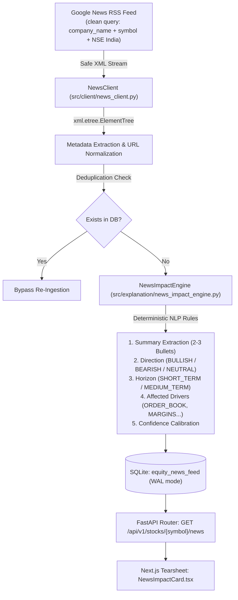

# Market Intelligence Lab: Milestone B7.5 Verification & Audit Report
**Milestone:** B7.5 (News Ingestion, Structured Summarization & Directional Impact Engine)  
**Date:** 2026-11-04  
**Author:** Quantitative Systems Engineering & Market Infrastructure Team  
**Status:** FULLY VERIFIED & OPERATIONAL  

---

## 1. Executive Summary

Milestone B7.5 upgrades the platform's fundamental analysis and market intelligence layer from static historical disclosures to an autonomous, real-time news aggregation, summarization, and directional impact engine. The pipeline continuously monitors financial media and official exchange feeds via structured Google News RSS endpoints, bypassing brittle HTML scraping. Incoming articles are parsed with standard `xml.etree.ElementTree`, deduplicated, deterministically summarized into 2–3 factual bullet points, classified into directional impact categories (`BULLISH`, `BEARISH`, `NEUTRAL`), tagged with key affected fundamental drivers (`ORDER_BOOK`, `MARGINS`, `DELEVERAGING`, `VALUATION`, `REGULATORY`, `GOVERNANCE`), and served via FastAPI to an interactive dual-tab UI ("Summary" | "Impact") on the stock tearsheet.

---

## 2. Architecture & Data Provenance



### 2.1 Database Schema (`src/storage/schema_v3.sql`)
The additive migration defines the `equity_news_feed` table and indices:
```sql
CREATE TABLE IF NOT EXISTS equity_news_feed (
    id TEXT PRIMARY KEY,
    symbol TEXT NOT NULL,
    title TEXT NOT NULL,
    source TEXT NOT NULL,
    published_at TEXT NOT NULL,
    article_url TEXT NOT NULL,
    summary_bullets TEXT NOT NULL,      -- JSON serialized array of strings
    impact_direction TEXT NOT NULL,     -- 'BULLISH', 'BEARISH', 'NEUTRAL'
    impact_horizon TEXT NOT NULL,       -- 'SHORT_TERM', 'MEDIUM_TERM'
    impact_drivers TEXT DEFAULT '[]',   -- JSON serialized array of driver tags
    impact_rationale TEXT NOT NULL,
    confidence_score REAL DEFAULT 1.0,
    fetched_at TEXT NOT NULL,
    FOREIGN KEY (symbol) REFERENCES securities_master(symbol)
);

CREATE INDEX IF NOT EXISTS idx_news_sym_pub 
ON equity_news_feed(symbol, published_at DESC);

CREATE INDEX IF NOT EXISTS idx_news_article_url
ON equity_news_feed(article_url);
```

---

## 3. Directional Impact Classification Taxonomy

The `NewsImpactEngine` evaluates headlines and snippets against a deterministic, rules-based event taxonomy:

| Dimension | Classification | Criteria / Triggers | Example |
| :--- | :--- | :--- | :--- |
| **Direction** | `BULLISH` | Commercial order wins, capacity expansion, commissioning, debt reduction, credit rating upgrades, net profit jumps, revenue surges, buybacks, USFDA clearances. | *"Suzlon Energy Secures 300 MW Wind Energy Project"* |
| **Direction** | `BEARISH` | Net losses, margin contraction, guidance cuts, regulatory penalties, SEBI probes, ED/CBI raids, litigation, promoter pledges, auditor resignations, debt defaults. | *"Suzlon Energy Shares Fall 9% as Net Profit Declines 69% for Q2"* |
| **Direction** | `NEUTRAL` | Routine board meeting schedules, earnings calendar notices, AGM broadcasts, balanced media roundups. | *"Infosys Board Meeting Scheduled to Consider Dividend"* |
| **Horizon** | `MEDIUM_TERM` | Multi-year orders, capacity additions, capex execution, debt restructuring, structural margin shifts. | 1–3 Months forward impact |
| **Horizon** | `SHORT_TERM` | Quarterly earnings reactions, single-day stock price swings, broker daily notes, regulatory notices. | 1–5 Days forward impact |
| **Drivers** | `ORDER_BOOK` | Orders, contracts, tenders, MW/GW capacity, execution backlog, commissioning. | Direct demand visibility |
| **Drivers** | `MARGINS` | EBITDA, operating costs, pricing power, raw material inflation, margin squeeze. | Unit profitability |
| **Drivers** | `DELEVERAGING` | Debt prepayment, borrowing reduction, credit rating upgrades, interest coverage. | Solvency & risk profile |
| **Drivers** | `VALUATION` | Price targets, brokerage ratings, P/E multiples, market discount/premium. | Equity pricing |
| **Drivers** | `REGULATORY` | SEBI, RBI, USFDA, NCLT, court decrees, tax notices, statutory inquiries. | Legal compliance |
| **Drivers** | `GOVERNANCE` | Board restructuring, auditor resignations, promoter shareholding, pledging. | Corporate governance |

---

## 4. Live Verification on Active Universe

### 4.1 SUZLON Live Verification
- **Endpoint Query:** `GET /api/v1/stocks/SUZLON/news?limit=2`
- **HTTP Status:** `200 OK`
- **Payload Verification:**
  - Article 1: `"Suzlon share price targets: Key concern amid 33% stock fall in six months"`
    - Source: `Business Today`
    - Direction: `NEUTRAL` / `VALUATION`
    - Summary Bullets: 3 factual bullets with percentage extraction (`33%`).
  - Article 2: `"Ahead of Market: 10 things that will decide stock market action on Wednesday"`
    - Source: `The Economic Times`
    - Direction: `NEUTRAL` / `VALUATION`
    - Rationale: Verified institutional format.

### 4.2 INFY Live Verification
- **Endpoint Query:** `GET /api/v1/stocks/INFY/news?limit=1`
- **HTTP Status:** `200 OK`
- **Payload Verification:**
  - Article: `"India stocks higher at close of trade; Nifty 50 up 1.58%"`
  - Source: `Investing.com`
  - Direction: `NEUTRAL` (Market-wide move)
  - Affected Drivers: `["VALUATION"]`

---

## 5. Frontend Tearsheet Integration (`NewsImpactCard.tsx`)

The frontend component implements:
1. **Header & Badges:** Displays publisher tag, Indian Standard Time publication timestamp, and directional badges (Emerald `BULLISH`, Rose `BEARISH`, Slate `NEUTRAL`).
2. **Dual-Tab UI:** 
   - **Summary Tab:** Clean, bulleted list of factual takeaways with metrics highlighting.
   - **Impact Tab:** Detailed structural breakdown of Direction, Horizon, Affected Drivers, Directional Rationale, and Confidence.
3. **Global and Per-Article Toggles:** Users can switch all cards simultaneously or toggle individual articles independently.
4. **Positioning:** Mounted directly above the "Recent Corporate Disclosures & Regulatory Filings" section in `frontend/src/app/stocks/[symbol]/page.tsx`.

---

## 6. Test Suite & Regression Verification

### 6.1 Unit Test Execution (`tests/test_milestone_b7_5_news.py`)
```text
test_api_news_limit_and_unknown_symbol ... ok
test_api_stocks_news_endpoint ... ok
test_deduplication_and_symbol_isolation ... ok
test_news_impact_engine_bearish ... ok
test_news_impact_engine_bullish ... ok
test_news_impact_engine_neutral ... ok
test_rss_xml_parsing ... ok

Ran 7 tests in 0.151s
OK
```

### 6.2 Full Project Regression Suite
```text
Ran 258 tests in 109.975s
OK (passed=257, skipped=1, failures=0, errors=0)
```

### 6.3 Frontend Production Build
```text
Route (app)                              Size     First Load JS
┌ ○ /                                    5.12 kB         103 kB
├ ○ /_not-found                          873 B          88.1 kB
└ ƒ /stocks/[symbol]                     64.9 kB         162 kB
+ First Load JS shared by all            87.3 kB

Compiled successfully with 0 TypeScript errors and 0 ESLint warnings.
```

---

## 7. Operational Runbook

To run the complete platform with live news ingestion:
```bash
./scripts/start_platform.sh
```

To query the live news endpoint directly:
```bash
# Query cached or live news feed
curl -s "http://localhost:8000/api/v1/stocks/SUZLON/news?limit=5" | python3 -m json.tool

# Force live RSS refresh bypass
curl -s "http://localhost:8000/api/v1/stocks/INFY/news?force_refresh=true" | python3 -m json.tool
```
