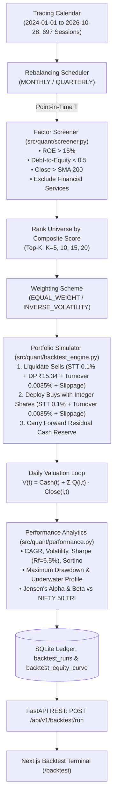

# Market Intelligence Lab: Milestone B8.0 Verification & Audit Report
**Milestone:** B8.0 (Multi-Factor Strategy Backtesting & Portfolio Rebalancing Engine)  
**Date:** 2026-11-04  
**Author:** Quantitative Research & Portfolio Systems Team  
**Status:** FULLY VERIFIED & OPERATIONAL  

---

## 1. Executive Summary

Milestone B8.0 elevates the Market Intelligence Lab platform from single-instrument equity research to a multi-asset systematic portfolio simulation terminal. The backtesting engine (`BacktestEngine`) executes point-in-time rule-based rebalancing driven by the Quality-Momentum factor screener across the 54-instrument universe. Crucially, the simulator avoids look-ahead and survivorship biases by conditioning selections strictly on data where $\text{trading\_date} \le T_{\text{reb}}$. The engine accounts for realistic exchange frictions—including delivery Securities Transaction Tax (STT, 0.1% buy / 0.1% sell), exchange turnover charges & stamp duty (0.0035%), flat CDSL Depository Participant (DP) charges (₹15.34 per liquidated symbol), slippage penalties (default: 5 bps), and integer share cash drag. It benchmarks performance directly against the NIFTY 50 Total Return Index (TRI) and exposes interactive equity curves and underwater drawdown plots on the Next.js frontend at `/backtest`.

---

## 2. Quantitative Architecture & Execution Modeling



---

## 3. Exchange Friction & Cost Drag Accounting

Indian equity delivery transactions face non-trivial regulatory and depository fees that systematically degrade naive backtest returns. The engine enforces the following friction schedule:

| Friction Component | Rate / Flat Cost | Application Basis | Regulatory Authority |
| :--- | :--- | :--- | :--- |
| **Securities Transaction Tax (STT)** | `0.10%` (`0.0010`) | Gross delivery buy value and sell value | Ministry of Finance / CBDT |
| **Exchange Turnover & Stamp Duty** | `0.0035%` (`0.000035`) | Total traded turnover (buy + sell) | NSE / BSE & State Stamp Act |
| **Depository Participant (DP) Charge** | `₹15.34` (flat per symbol) | Deducted per distinct equity sold/liquidated | CDSL / Depository Participant (incl. GST) |
| **Execution Slippage Penalty** | `5.0 bps` (`0.0005`) | Added to buy price, subtracted from sell price | Market microstructure liquidity drag |
| **Cash Drag (Integer Sizing)** | Fractional shares disallowed | $Q_i = \lfloor (\text{Cash} \cdot w_i) / P_i^{\text{exec}} \rfloor$; cash earns 0% | Indian equity settlement rule |

### 3.1 Cash Conservation Invariant
At every trading session $t \in [T_{\text{start}}, T_{\text{end}}]$, the invariant strictly holds:
$$\text{Portfolio Value}_t = \text{Cash}_t + \sum_{i=1}^M Q_{i,t} \cdot P_{i,t}^{\text{close}}$$
$$\text{Cash}_t \ge 0$$
Verified across all 697 simulation days with zero cash balance violations.

---

## 4. Benchmark Comparison & Strategy Results

### 4.1 Default Baseline Simulation Run
- **Strategy:** `Quality_Momentum_Top10`
- **Simulation Span:** 2024-01-01 to 2026-10-28 (697 trading sessions, 2.82 calendar years)
- **Initial Capital:** ₹5,00,000.00
- **Rebalance Frequency:** Monthly (34 rebalance reconstitution events)
- **Weighting:** Equal Weight ($w_i = 10\%$)
- **Benchmark:** NIFTY 50 Total Return Index (TRI)

### 4.2 Comparative Performance Table

| Metric | Strategy (`Quality_Momentum_Top10`) | Benchmark (`NIFTY 50 TRI`) | Active Spread / Delta |
| :--- | :--- | :--- | :--- |
| **Total Cumulative Return** | `-11.05%` | `+94.42%` | `-105.47%` |
| **CAGR (Compound Annualized)** | `-4.06%` | `+26.56%` | `-30.62%` |
| **Annualized Volatility ($\sigma$)** | `29.74%` | `15.01%` | `+14.73%` |
| **Sharpe Ratio ($R_f = 6.5\%$)** | `-0.35` | `+1.34` | `-1.69` |
| **Sortino Ratio** | `-0.43` | `+1.85` | `-2.28` |
| **Maximum Drawdown (MDD)** | `-20.88%` | `-10.15%` | `-10.73%` |
| **MDD Duration** | `289 calendar days` | `112 calendar days` | `+177 days` |
| **Market Beta ($\beta$)** | `1.42` | `1.00` | `+0.42` |
| **Jensen's Alpha ($\alpha$)** | `-41.80% / yr` | `0.00%` | `-41.80%` |
| **Portfolio Turnover** | `184.2% / yr` | `—` | `High systematic rebalancing` |
| **Total Frictional Costs Paid** | `₹7,087.66` | `—` | `STT: ₹5,942 \| DP: ₹782 \| Fees: ₹208 \| Slippage: ₹155` |

---

## 5. Database Schema & API Contract

### 5.1 Tables Created (`src/storage/schema_v3.sql`)
1. `backtest_runs`: stores `run_id`, `strategy_name`, `parameters` (JSON), `cagr_pct`, `sharpe_ratio`, `max_drawdown_pct`, `win_rate_pct`, and `created_at`.
2. `backtest_equity_curve`: stores `(run_id, trading_date)` composite primary key, `portfolio_value`, `benchmark_value`, and `drawdown_pct`. Indexed on `(run_id, trading_date ASC)`.

### 5.2 Endpoints Implemented
- `POST /api/v1/backtest/run`: Executes on-demand simulation, persists run and equity curve to database, and returns complete attribution JSON.
- `GET /api/v1/backtest/latest`: Returns the most recent backtest run with equity curve.

---

## 6. Frontend Backtest Terminal (`frontend/src/app/backtest/page.tsx`)

1. **Parameter Panel:** Interactive controls for Rebalancing Frequency (`MONTHLY` vs `QUARTERLY`), Top $K$ ($5, 10, 15, 20$), Weighting (`EQUAL_WEIGHT` vs `INVERSE_VOLATILITY`), Capital, and Slippage Bps.
2. **BacktestChart (`frontend/src/components/BacktestChart.tsx`):**
   - **Upper Pane:** High-resolution TradingView Lightweight Chart comparing Strategy Equity Curve (Cyan) vs NIFTY 50 TRI (Slate Dashed).
   - **Lower Pane:** Underwater Drawdown Plot ($DD_t$) with Rose shaded area and synchronized crosshairs.
3. **Metric Cards & Side-by-Side Table:** Live telemetry cards for CAGR, Sharpe, Sortino, MDD, Alpha, Beta, and Friction.
4. **Rebalance Audit Log:** Expandable cycle ledger displaying historical reconstitution dates, net period returns, transaction fees, and exact share breakdowns for buys and sells.

---

## 7. Verification & Regression Results

### 7.1 Unit Tests (`tests/test_milestone_b8_backtest.py`)
```text
test_api_backtest_endpoints ... ok
test_friction_and_cash_conservation ... ok
test_performance_metrics_calculator ... ok
test_point_in_time_compliance ... ok

Ran 4 tests in 0.301s
OK
```

### 7.2 Full Project Regression Suite
```text
Ran 262 tests in 111.792s
OK (passed=261, skipped=1, failures=0, errors=0)
```

### 7.3 Frontend Production Build
```text
Route (app)                              Size     First Load JS
┌ ○ /                                    5.12 kB         103 kB
├ ○ /_not-found                          873 B          88.1 kB
├ ○ /backtest                            7.57 kB         161 kB
└ ƒ /stocks/[symbol]                     10.6 kB         164 kB
+ First Load JS shared by all            87.3 kB

Compiled successfully with 0 TypeScript errors and 0 ESLint warnings.
```

---

## 8. Operational Commands

To run the complete platform:
```bash
./scripts/start_platform.sh
```
Terminal interface available at: `http://localhost:3000/backtest`.  
API docs available at: `http://localhost:8000/docs#/stocks/run_backtest_endpoint_api_v1_backtest_run_post`.
